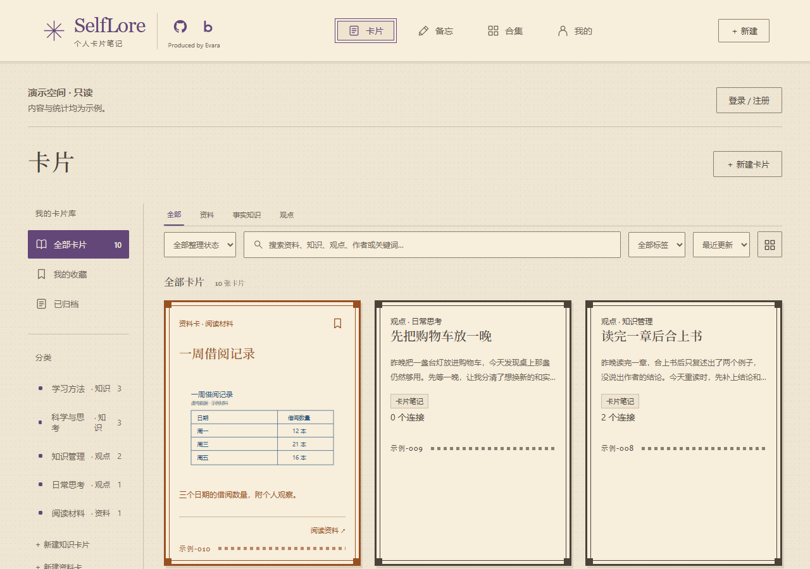
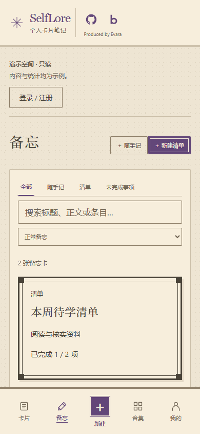

# SelfLore

[](https://github.com/evara0/selflore/actions/workflows/ci.yml)

SelfLore 是一个个人卡片笔记应用，用来收纳外部资料、整理事实知识、记录自己的观点，并用备忘和清单安排待办与待学内容。

**[在线演示：selflore.evara.blog](https://selflore.evara.blog)**

未登录时可浏览独立的只读演示空间，内容与统计均为示例；登录后管理自己的真实数据。

## 可以做什么

| 入口 | 用途 |
| --- | --- |
| 卡片 | 统一收纳资料、事实知识和原子观点，支持搜索、分类、标签及关联引用 |
| 备忘 | 随手记、待办与待学清单；条目可标记完成并关联卡片 |
| 合集 | 将不同类型卡片编排在一起，集中浏览与翻阅 |
| 我的 | 个人资料、内容积累与学习足迹 |

- **资料卡**：保存外部摘录或图片，记录来源链接、作者等信息；原材料与自己的说明分开，收录不代表认同。
- **事实知识**：用问答或填空组织知识，支持 FSRS 间隔复习。
- **原子观点**：记录自己的想法，通过稳定编号和双向链接连接其他卡片。
- **备忘**：记录行动和学习安排；资料卡、观点及备忘均不进入知识复习。

## 界面预览

截图来自当前开发版本的只读演示空间，内容均为合成示例，线上版本可能暂未包含最新改动。[截图来源与更新说明](assets/screenshots/README.md)。

**桌面：统一卡片库**



**手机：备忘与待学清单**



## 技术栈

| 部分 | 实现 |
| --- | --- |
| 前端 | React、TypeScript、Vite、React Router、TanStack Query；pnpm 锁定依赖 |
| 后端 | Python 3.13+、FastAPI、psycopg；uv 锁定依赖 |
| 数据 | PostgreSQL 18、不可变 SQL 增量迁移；图片保存到独立私有文件目录 |
| 验证 | GitHub Actions基础CI：文档、前端和后端；pytest、Vitest、Playwright、Oxlint；前端展示变更另需浏览器视觉审查 |

## 本地运行

需要 Python 3.13+、uv、Node.js 22.12+、pnpm 10.33.0 和 PostgreSQL 18。以下为 **Windows PowerShell** 的固定启动方式，在仓库根目录执行：

1. 按[数据库初始化](apps/api/DATABASE_SETUP.md)准备 `dev` 数据库、角色及完整迁移链。固定启动入口使用 `127.0.0.1:6171`；通用文档中的 `5432` 示例应替换为 `6171`。
2. 配置应用角色密码并启动：

   ```powershell
   .\start-local.cmd -Configure
   .\start-local.cmd
   ```

3. 打开 [http://127.0.0.1:24566](http://127.0.0.1:24566)，按 `Ctrl+C` 停止。

启动脚本会同步锁定依赖、构建前端并由 API 提供页面；**不会安装 PostgreSQL 或自动迁移数据库**。图片上传还需按[图片存储说明](MEDIA_STORAGE.md)初始化媒体目录。详细配置与排障见[本地启动说明](LOCAL_START.md)。

需要前端热更新时，按 [API 配置与运行](apps/api/AUTH_CONFIGURATION.md)启动后端，再在 `apps/web` 执行 `pnpm install --frozen-lockfile`、`pnpm dev`，访问 `http://127.0.0.1:24567`。其他环境可参考通用数据库与 API 配置说明；一键脚本依赖 Windows。

## 目录结构

```text
apps/
  web/                React 前端：src/features、components、lib；e2e 浏览器测试
  api/                FastAPI 后端：app、migrations、tests
scripts/              本地启动、备份、媒体诊断及CI辅助脚本
assets/screenshots/   README使用的公开演示截图及来源说明
openspec/
  specs/              当前能力规格
  changes/            活跃变更与 archive 历史记录
```

后端业务主要位于 `app/routers`、`schemas`、`services`，数据库访问辅助函数位于 `repositories`。前后端分别在各自目录管理依赖。

本机的 `docs/`、`deploy/`、`local-deployment/`、备份及缓存被 Git 忽略，不随仓库交付；具体服务器接入和自动发布工具属于维护者本机资料。克隆后运行应用可使用下列公开说明。

## 详细说明

产品功能与技术概览统一维护在本页；专项文档只负责对应操作，历史验收保留在 OpenSpec 变更记录中。

| 需要了解 | 文档 |
| --- | --- |
| 本地启动与诊断 | [LOCAL_START.md](LOCAL_START.md) |
| 数据库首次准备与后续迁移 | [数据库初始化](apps/api/DATABASE_SETUP.md) · [迁移说明](apps/api/CARD_MIGRATIONS.md) |
| 认证配置、首位管理员及手动运行 | [认证配置](apps/api/AUTH_CONFIGURATION.md) |
| 接口与数据交互 | [工作区 API](apps/api/WORKSPACE_API.md) |
| 仓库CI、测试与前端视觉审查 | [自动CI](apps/api/WORKSPACE_TESTING.md#仓库自动-ci) · [本地验证](apps/api/WORKSPACE_TESTING.md) |
| 图片上传、存储及排查 | [MEDIA_STORAGE.md](MEDIA_STORAGE.md) |
| 开发库备份与恢复演练 | [DATABASE_BACKUP.md](DATABASE_BACKUP.md) |
| 日常维护与排障 | [MAINTENANCE.md](MAINTENANCE.md) |

## 参与贡献

问题反馈和功能建议请使用[GitHub Issues](https://github.com/evara0/selflore/issues/new/choose)。准备修改代码或文档时，先阅读[贡献指南](CONTRIBUTING.md)，其中说明了开发入口、验证要求及PR流程。

## 许可证

SelfLore采用[Apache License 2.0](LICENSE)。第三方依赖和引用材料适用各自许可；用户自行保存的笔记、图片及来源材料不因使用本项目而自动获得此许可。
